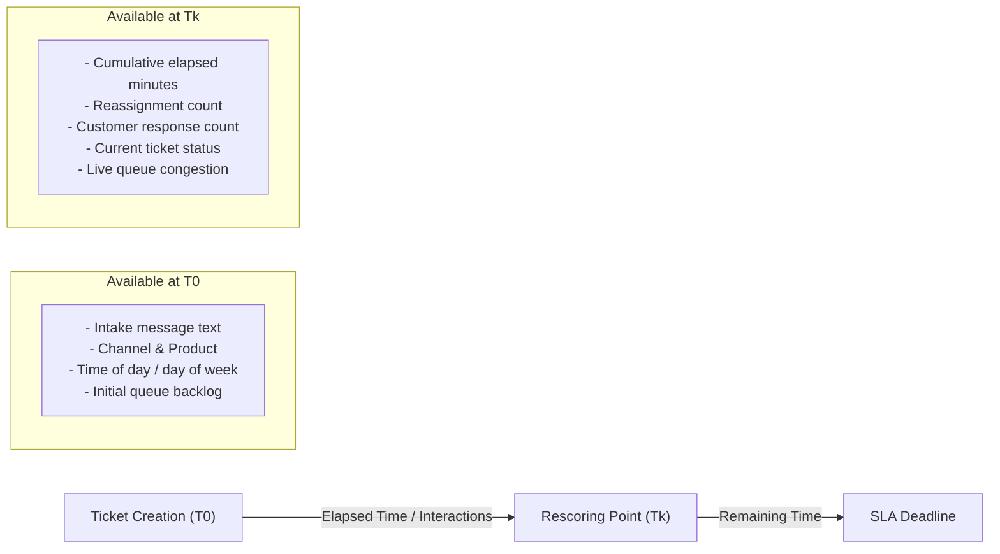

# Operational Data Collection Plan: Supervised SLA Breach Prediction & Rescoring

> [!NOTE]
> **Purpose**: This plan outlines the requirements for capturing real-world operational event streams to train, calibrate, and validate production SLA risk models. It replaces synthetic benchmark assumptions with rigorous operational data collection specifications.

---

## 1. Problem Statement & Motivation
The offline feasibility study (`run_006_sla_risk_feasibility`) demonstrated that while models can pick up static text patterns, real SLA compliance is driven by operational execution dynamics: agent availability, queue congestion, customer reply latency, reassignment delays, and business hours.

To build an operational SLA risk model that can genuinely forecast first-response and resolution breaches—both at ticket creation ($T_0$) and dynamically during ticket progression ($T_k$)—the platform must systematically log timestamped lifecycle events and freeze policy contexts.

---

## 2. Event Sourcing & Lifecycle Event Architecture

To prevent data leakage and enable retrospective replay, the platform should capture ticket transitions as an append-only event stream:

### Proposed Schema: `ticket_events`
```sql
CREATE TABLE ticket_events (
    id UUID PRIMARY KEY DEFAULT gen_random_uuid(),
    tenant_id UUID NOT NULL REFERENCES tenants(id) ON DELETE CASCADE,
    ticket_id UUID NOT NULL,
    event_type VARCHAR(64) NOT NULL,
    occurred_at TIMESTAMPTZ NOT NULL DEFAULT NOW(),
    actor_type VARCHAR(32) NOT NULL, -- 'system', 'agent', 'customer', 'worker'
    actor_id VARCHAR(128),
    payload JSONB NOT NULL DEFAULT '{}'::jsonb,
    CONSTRAINT fk_ticket_events_tickets FOREIGN KEY (tenant_id, ticket_id)
        REFERENCES tickets(tenant_id, id) ON DELETE CASCADE
);
CREATE INDEX idx_ticket_events_ticket_time ON ticket_events (tenant_id, ticket_id, occurred_at ASC);
```

### Mandatory Lifecycle Event Types
1. `ticket_created`: Raw intake message, channel, initial assigned priority/category.
2. `ticket_assigned`: Agent assignment, queue routing.
3. `first_response_sent`: Outbound agent message timestamp (completes first-response SLA target).
4. `customer_replied`: Inbound customer response adding new information or reopening dialogue.
5. `priority_changed`: Explicit priority adjustment by human agent or policy rule.
6. `status_changed`: State transitions (`new` $\to$ `open` $\to$ `pending` $\to$ `resolved` $\to$ `closed`).
7. `ticket_resolved`: Problem resolution recorded (completes resolution SLA target).
8. `ticket_reopened`: Reopening after initial resolution.

---

## 3. SLA Policy Snapshotting & Calendar Semantics

### Immutable Policy Snapshotting
In operational support environments, administrators periodically update SLA policies (e.g. shortening High-priority response targets from 60 minutes to 30 minutes).
- **Requirement**: When a ticket is created or its priority is modified, the system must write an immutable snapshot of the effective policy parameters (`first_response_minutes`, `resolution_minutes`, `policy_id`) directly to the ticket or event log.
- **Rationale**: Future evaluation must judge historical compliance against the SLA deadline that was actually committed at the time the ticket was open, not policies modified weeks later.

### Calendar & Operating Hours Semantics
- **Wall-clock Elapsed Time**: Useful for 24/7 infrastructure monitoring.
- **Business Hours Schedules**: Crucial for enterprise B2B support (e.g. 9 AM to 5 PM Monday–Friday, excluding regional bank holidays).
- **Collection Requirement**: Every tenant must define their timezone and operational schedule. Event processors must calculate both raw calendar elapsed minutes and active business-hour minutes to support dual target modeling.

---

## 4. Information Boundaries: $T_0$ Intake vs $T_k$ Dynamic Rescoring

### Observation Horizon ($T_{\text{obs}}$) Integrity
Features for any model prediction evaluated at time $T_{\text{obs}}$ must only use information generated strictly prior to $T_{\text{obs}}$ ($\text{occurred\_at} \le T_{\text{obs}}$).



### Rescoring Eligibility Rules
A ticket is eligible for dynamic SLA risk rescoring at time $T_k$ if and only if:
1. The target is **incomplete** (`first_response_at IS NULL` for first-response target; `resolved_at IS NULL` for resolution target).
2. The current observation time $T_k$ is strictly **before the target deadline** ($T_k < \text{due\_at}$).
3. The ticket is in an active non-terminal status (`new`, `open`, or `pending`).

> [!IMPORTANT]
> If $T_k \ge \text{due\_at}$, the ticket is **already breached**. This is a deterministic operational fact, not an ML prediction. Setting an ML score to 1.0 post-breach is artificial and introduces evaluation leakage.

---

## 5. Incomplete Outcomes & Censoring (Survival Analysis)

### Handling Open Tickets
In active production systems, thousands of tickets are currently open without known resolution timestamps.
- **Naive Exclusion Bias**: Discarding all open tickets biases training data toward fast resolutions, artificially under-representing slow and difficult tickets.
- **Snapshot-based Evaluation**:
  - Sample tickets across historical calendar cutoff dates (e.g., every Monday at 09:00 UTC).
  - Observe features as of the cutoff date $T_{\text{obs}}$.
  - Evaluate whether breach occurred after $T_{\text{obs}}$.
  - For tickets that were subsequently resolved, the ground-truth outcome is known. For tickets that remained unresolved past their deadline, breach is known ($Y = 1$). For tickets that were closed without breach within the observation window, non-breach is known ($Y = 0$).

---

## 6. Multi-Tenant Isolation, Retention & Privacy

### Multi-Tenant Data Boundaries
- **Strict Tenant Scoping**: All event queries, feature aggregation pipelines, and training extracts must be filtered by `tenant_id`.
- **Pooled vs Tenant-Specific Models**:
  - **Pooled Base Model**: Train a single shared model across anonymized tenant data using standard tenant-level covariates (e.g. tenant volume tier, channel distribution) rather than separate per-tenant models.
  - **No Justification for Premature Per-Tenant Tuning**: Individual tenants rarely possess the thousands of completed, audited ticket lifecycles required to fit a stable deep or tree-based model without extreme overfitting.

### Privacy, PII & Data Retention
1. **PII Sanitization**: Before text or event payloads are exported to training datasets, regex and named-entity filters must strip customer names, account numbers, credit card numbers, email addresses, and phone numbers.
2. **Right to Be Forgotten (GDPR/CCPA)**: When a customer or tenant requests data erasure, historical operational event text must be scrubbed while preserving anonymized numerical metrics (durations, token counts, target outcomes) to keep historical benchmark distributions stable.
3. **Data Retention Limits**: Event streams older than the agreed retention period (e.g. 180 or 365 days) must be archived or rolled up into daily operational summary aggregates.
